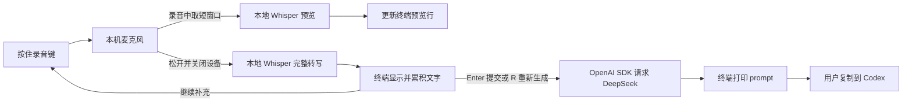

# 结构与重要决策

更新于 2026-11-22。首版实现按键录音、本地转写及 OpenAI SDK 调用。真实设备上的整段体验与付费请求结果见[验证记录](DEVELOPMENT.md)。

## 当前结构

`talk2coding.py` 是唯一的应用文件。主入口由 `if __name__ == "__main__":` 调用 `main()`。主线程处理键盘和会话，PortAudio 回调只写有界 PCM 缓冲区。录音期间，主线程取短窗口的不可变快照，交给一个标准库后台线程预览。松开后先关闭录音流，等当前预览任务退出，再转写整段。主线程始终负责终端输出，模型同一时刻只运行一个任务。模块导入时只加载标准库并定义对象。

| 路径 | 职责 |
| --- | --- |
| `talk2coding.py` | 终端控制、录音、转写、配置读取与生成 |
| `.env.example` | 三项 DeepSeek 配置的无凭证示例 |
| `requirements.txt`、`constraints.txt` | 固定直接依赖及 PyAV 兼容约束 |
| `.github/workflows/template-checks.yml` | 规则一致性和 Windows 离线检查 |
| `.local/whisper/` | 下载的本地模型缓存，由 Git 忽略 |

## 入口与输入输出

| 函数 | 输入 | 行为与输出 |
| --- | --- | --- |
| `main()` | 命令行和终端 | 分派诊断或预加载命令，检查麦克风，准备模型，启动会话 |
| `run_session(...)` | 已加载模型、麦克风、键名 | 显示各段，响应补充、替换末段、清空、提交和重新生成 |
| `record_segment(...)` | PortAudio 设备、功能键和预览控制器 | 按住时采集单声道 16 位 PCM，同步轮询预览结果，关闭流后返回整段内存 WAV |
| `LivePreview` | 已加载模型、有界 PCM 缓冲区 | 每增加约 2 秒音频且线程空闲时，最多拿最近 8 秒去识别。未完成时跳过调度，避免排队 |
| `transcribe_segment(...)` | 内存 WAV、Whisper | 启用 VAD 和中文标点风格示例。整段转写根据词时间戳保守分句，预览跳过词对齐 |
| `read_deepseek_config(...)` | 项目根目录的 `.env`，进程环境 | 返回键、HTTPS 根地址、模型名。相同键以进程环境优先 |
| `generate_prompt(...)` | 当前转写和配置 | 用 OpenAI SDK 发起一个文本请求，返回完整 Markdown 正文 |

程序通过 Win32 `GetAsyncKeyState` 检查可配置功能键，默认 F7，使用 `msvcrt` 从本终端接收命令。释放、Esc、丢帧或退出均关闭音频流。单段最长 120 秒。预览采用每次短窗的识别结果，终端覆盖上一条预览，采集结束后清除。预览可能随新音频修正。松开后的整段转写和生成期间不排队处理新按键。成功生成会清空本次段落，失败会保留文字供手动重试。[Win32 键状态](https://learn.microsoft.com/en-us/windows/win32/api/winuser/nf-winuser-getasynckeystate) · [Python 控制台输入](https://docs.python.org/3.13/library/msvcrt.html)

## 模型、依赖与数据边界

- 音频经 `sounddevice 0.5.6` 进入内存，由 `faster-whisper 1.2.1` 使用 Whisper large-v3-turbo 在 CPU 上以 `int8` 运行。默认首次下载固定 revision 的 MIT CTranslate2 权重，已缓存权重和 `--model-dir` 提供的文件可直接加载。PyAV 固定 18.1.1 以兼容所选转写库的解码接口。若实测精度或延迟不足，用同一批样本再评估 GPU、Whisper large-v3 或 Qwen3-ASR。[权重来源](https://huggingface.co/dropbox-dash/faster-whisper-large-v3-turbo/commit/0a363e9161cbc7ed1431c9597a8ceaf0c4f78fcf) · [faster-whisper](https://github.com/SYSTRAN/faster-whisper)
- `openai 3.57.0` 用于调用用户配置的 DeepSeek 兼容 HTTPS 端点，替代最初的标准库 HTTP 预案。默认根地址是 `https://api.deepseek.com`，默认模型 `deepseek-flash`。`DEEPSEEK_BASE_URL` 和 `MODEL_NAME` 可显式覆盖默认值。[OpenAI Python 接口](https://developers.openai.com/api/reference/python/resources/chat/subresources/completions/methods/create) · [DeepSeek 官方接入](https://api-docs.deepseek.com/quick_start)
- Enter 发送草稿，R 使用内存中的最近提交重新请求一次。R 保留后来录制的新草稿，C 清空草稿与最近提交。键释放后可重新提交，SDK 的自动重试关闭。只发送本次选中的转写和固定整理指令，终端输出通过标题校验的完整 Markdown。
- 中文整段转写保留模型已有标点。后处理在较长停顿处补逗号并补缺失的句末句号，避开常见否定、条件或限制词后和纯英文数字边界。该规则不会纠正识别错词，词时间戳仅在松开后启用。

验收依据见 [PROJECT.md](PROJECT.md)。运行与测试见 [DEVELOPMENT.md](DEVELOPMENT.md)。
